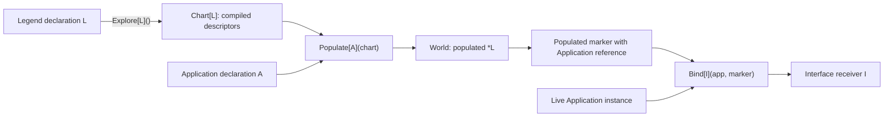

Sail
====

## Packages

Sail has two public packages in one module:

| Import | Responsibility |
| --- | --- |
| `github.com/qlustra/sail/legend` | Authoring vocabulary: markers, lanes, spots, features, qualifiers, barrels, qualities, acceptance declarations, hook interfaces, and `Self`. These types also hold populated state. |
| `github.com/qlustra/sail` | Operations: `Chart[L]`, `Explore`, `Populate`, `Bind`, `ReadCapability`, and `ResolvePointerChain`. `Course` and traversal remain placeholders. |

Declaration examples use `legend`:

```go
import "github.com/qlustra/sail/legend"

type ProgramLegend struct {
	legend.Legend
	// Declare lanes and spots here.
}

func (ProgramLegend) Mark() string { return "app" }
```

Orchestration imports root `sail` for `sail.Explore[ProgramLegend]()` and
`sail.Populate[App](chart)`.

The implementation is organized under `internal/`:

| Package | Responsibility |
| --- | --- |
| `declaration` | Canonical declaration carriers, populated state, application references, and the sealed access used by the engine. Public `legend` types alias these carriers. |
| `engine` | Compiled descriptors, exploration, population, and live binding through application references. |
| `capability` | Interface contract matching, declaration capability readers, and guarded declaration invocation. |
| `tags` | Tag parsing and validation. |
| `reflectutils` | Type inspection, field access, and receiver binding, independent of Sail's declaration model. |

`Chart[L]` keeps compiled descriptors private. Public `legend` carriers alias
canonical internal declaration types, so reflection reports those canonical type
names. The aliases retain the sealed protocols used for inspection and population
without exposing those operations in the public declaration API.

Consumers use the public packages. The internal division introduces no additional
module or World wrapper; the populated result remains `*L`.

## Vocabulary and lifecycle

Sail is a meta-framework for interpreting application declarations. A framework
such as Dome authors a **Legend**; a CLI authors an **Application**.

| Term | Meaning |
| --- | --- |
| Legend | The framework's authored declaration, rooted in `legend.Legend`, describing markers, ordered lanes, spots, metadata, and contracts. |
| Chart | The reusable compiled descriptor graph produced by exploring with a Legend. Its Go type is `sail.Chart[L]`. |
| Application | The consumer's Go declaration `A`, or a live instance of it. State which when the distinction matters. |
| World | The populated `*L` describing a particular Application declaration. It holds marker occurrences and their metadata. |
| Populated marker | A marker value representing a particular place in the Application declaration. |
| Application reference | A populated marker's recorded root type, receiving type, and field path, used for later live binding. |

**Declarations** are authored Go structures. **Descriptors** are Sail's internal
compiled representation. The World currently reuses the Legend's Go shape as
its storage: `Populate` returns `*L`, not a separate `World[L]` wrapper.



Exploration and population inspect declarations. Population invokes declared
capabilities on zero-valued surrogates; it requires no live Application instance.
Binding resolves a populated marker against existing Application storage. Navigation,
Course selection, and cascading walking remain unimplemented.

## Population

`Explore[L]()` builds a Chart with the Legend declaration L.
`Populate[A](chart)` returns a fresh World (`*L`) populated against **A's type**.
The Chart holds reusable descriptors; populated markers hold metadata and
Application references for individual occurrences. Markers expose
`ApplicationType()` and a copied `ApplicationPath()` so consumers can interpret
receiving types and retain declaration order across spot kinds.

Population reads marked Application fields in declaration order, selecting spots
within the current lane. An unmatched field advances to the next lane only
after the current lane's minimum counts are satisfied. A matched spot exceeding
its maximum fails immediately; population does not retry another lane to make
the counts fit. End of declaration validates every remaining minimum.

Features receive text from their named tags. Qualifiers receive the remaining
mark values after discriminant selection. Untagged fields are ignored; marked
fields must be exported and match a remaining spot. Legends and regions apply
to structs (including through pointers); landmarks describe leaf declarations.

Single spots hold one marker in `Value`, optional spots hold a marker pointer
or nil in `Value`, and multi spots hold a slice in `Value`. Repeated Application
types are populated independently.
Composite spot declarations must embed their spot carrier and intermediate
wrappers by value. Exploration rejects pointer embeddings along that chain;
`OptionalSpot.Value` still uses nil to represent an absent occurrence.
An active cycle of the same marker and Application types is rejected because it
would require an infinite expansion. Live Application binding remains separate.

## Live binding

`Bind[I](app, marker)` resolves one populated marker against the live
Application and returns an ordinary Go interface receiver:

```go
command := &world.EntryPoint.MainCommand.Value
receiver, present, err := sail.Bind[Runnable](&program, command)
if err != nil {
	return err
}
if present {
	return receiver.Run(ctx)
}
```

The root must be a nonnil pointer leading to the exact recorded root type;
additional pointer wrappers are allowed. Sail follows the stored field path
without allocating Application storage or constructing addressable copies.
Addressable concrete fields bind through their address when it implements I, preserving the
connection to their original storage even for value-receiver interfaces.

Interface fields expose their current dynamic receiver. A stored non-pointer
value follows normal Go value semantics; if only its pointer implements I, an
addressability error is returned. Replacing a pointer or interface field requires
rebinding to obtain the replacement. Nil maps and slices remain valid values.

`present == false` without an error means that the existing receiver does not
implement I. Wrong roots, unpopulated or nil markers, missing pointer/interface
storage, inaccessible receivers, and receiver cycles produce contextual errors.
I must be an interface; `Self` signature templates are not substituted into a
runtime Go interface.

Binding invokes no Application methods and does not traverse siblings or descendants.
The caller owns invocation and its error handling. Course selection and cascading
walking remain separate work.

## Acceptance

A marker can constrain its receiving type with an optional declaration hook:

```go
func (EnumOptionLandmark) Accept() legend.Acceptance {
	return legend.AcceptExact[bool]()
}
```

Exploration invokes `Accept` once per marker declaration type on its zero-valued
surrogate and records the compiled rule in its descriptor. Returning an empty `legend.Acceptance`, an invalid
kind or contract, or panicking in the hook fails exploration. The declaration
builders do not panic on invalid input. Without the hook, existing role
requirements apply.

Each declaration selects one rule:

- `AcceptExact[T]()` compares the original declared type. Aliases of T pass;
  distinct defined types and pointers to T do not. Interface types also match
  by identity: `AcceptExact[any]()` requires a field declared `any`.
- `AcceptKind(reflect.String)` compares the original declared kind. Defined
  string types pass; pointers do not. Collection kinds impose no element
  constraints. `reflect.Invalid` and unknown kinds are invalid declarations.
- `AcceptContract[I]()` requires an interface contract, using the same signature
  matching as qualities. Pointer chains resolve to a receiving type T, preserving
  defined-type identity. Concrete types support methods on T or *T; interface
  declarations use their own method set. Direct `Self` parameters and results
  resolve to T, including when T is an interface. No surrogate is constructed
  and no Application method is invoked. Non-interface contracts and unsupported
  `Self` signatures fail exploration. Barrels and qualities still require
  concrete receivers for invocation.

Population checks acceptance before filling that occurrence's metadata,
descending, or invoking its capabilities. Legends and regions must still resolve
to structs. Rule combinations and collection element constraints are not defined.

Marks and lanes select the occurrence first. An acceptance mismatch fails with
the Application path, marker, expected type, and actual type; it does not retry
another spot or advance the lane. Only selected occurrences are checked;
untagged fields remain outside population.

## Barrels

A barrel declares a capability, selects a method, and stores its result during
population:

```go
type Descriptive interface {
	About() string
}

type CommandRegion struct {
	legend.Region
	Description legend.Barrel[string, Descriptive] `sail:"barrel" populate:"About"`
}

func (CommandRegion) Family() string { return "command" }
```

The capability must be an interface. Its selected method must be exported, take
no arguments, and return exactly one value assignable to the barrel's value
type. Exploration validates this contract before any World is populated.

Omitting `barrel` means `barrel:"optional"`: an unavailable capability leaves
the barrel empty. `barrel:"required"` instead makes absence a population error.
Availability requires a concrete receiving type whose pointer implements the
interface; this covers value and pointer methods. An interface-typed Application
field cannot supply a concrete surrogate from its static declaration alone.

After the occurrence's fields and child lanes are populated, each barrel calls
its selected method on a fresh zero-valued surrogate. Hooks must work without
initialized application state. A hook panic fails population with the Application
path and barrel field in the error. Multiple barrels may select the same method;
they invoke independently and each stores its result.

`Description.Get()` reads the stored value. `Description.Present()` distinguishes
an absent capability from a successful call returning `""`, zero, or nil. Neither
accessor invokes hooks or validates values. No separate behavior registration or
population hook is required.

## Qualities

A qualifier composite can declare capabilities required when its symbol is
present on an Application occurrence:

```go
type Defaultable[T any] interface {
	Default() T
}

type DefaultQualifier struct {
	legend.Qualifier
	Value legend.Quality[any, Defaultable[legend.Self]] `sail:"quality" populate:"Default"`
}

type Argument struct {
	legend.Landmark
	Default DefaultQualifier `sail:"qualifier" symbol:"default"`
}

func (Argument) Family() string { return "arg" }

type Remote string

func (Remote) Default() Remote { return "origin" }
```

For an Application field `Remote Remote` marked with `arg,default`, population
requires and invokes `Default() Remote`. Without the qualifier, the quality
stays inactive: no capability is required or invoked. This association comes
from nesting, not from the symbol's meaning. Reusable qualifier wrappers retain
the qualities declared along their embedded `Qualifier` path.

`Self` matches the receiving type after pointer normalization, preserving
defined-type identity. It is a signature placeholder, not a Go interface that
the Application type must literally implement. Sail checks the entire capability's
method set. This slice supports Self directly in method parameters and results;
compound uses such as `[]Self` and `*Self` fail exploration. Interfaces using
Self must have exported methods. Ordinary interfaces use Go's implementation
rules, including private methods.

The selected `populate` method must be exported, take no arguments, and return
one value. Fixed result types are checked for assignability to the storage type
during exploration; Self results are checked during population. Self cannot be
used as the storage type. With `any`, `arg.Default.Value.Get()` returns an
interface containing the actual `Remote` value, not a converted string.

Each active quality invokes its method on a fresh zero-valued surrogate, after
the occurrence's fields and child lanes are populated. Missing or mismatched
capabilities, incompatible storage, and hook panics fail population with the
Application and qualifier context. `Present()` distinguishes an inactive quality
from a successful zero or nil result. Reading a quality never invokes or
validates its value. Live-value parsing and validation remain separate.

## Declaration utilities

`ResolvePointerChain(typ)` follows pointer types without erasing the identity of
the resulting defined type. Nil input or a pointer cycle returns nil. An
interface remains an interface; a declaration alone cannot resolve its concrete
implementation.

`ReadCapability[V, I](typ, method)` reads a declaration capability without a
Chart or qualifier. It uses the same contract matching and invocation machinery
as qualities:

```go
value, present, err := sail.ReadCapability[any, Defaultable[legend.Self]](
	reflect.TypeFor[Remote](), "Default",
)
```

I must be an interface. Its selected method must be exported, take no arguments,
and return one value assignable to V. Self follows the same direct-signature
rules as qualities. In this example, `value` contains a `Remote`, preserving its
dynamic type.

An unavailable or incompatible capability returns `present == false` without
an error. This includes nil, cyclic pointer, and interface Application types that
cannot supply a surrogate. Invalid capability requests, incompatible storage,
and hook panics return errors. A successful zero or nil result still returns
`present == true`.

Every call constructs a fresh zero-valued surrogate and invokes independently;
it does not access a live Application or cache results. The caller decides whether
to request a capability and how to use its result. Qualities instead retain
their compiled reader in the Chart and require presence when activated.

## Lane policies

Lanes form ordered bands in an Application declaration. Spots are unordered
alternatives within a lane. The `exploration` tag declares how fields are
assigned to lanes:

| Policy | Meaning |
| --- | --- |
| `eager` | Stay in the current lane while it accepts the field. |
| `unambiguous` | Reject structural overlap between reachable lanes during exploration. |

Omitting `exploration` selects `unambiguous`.

Exploration rejects an unambiguous lane whose marks overlap a following lane
reachable through zero-occurrence lanes. A lane permits zero occurrences only
when every spot's minimum is zero. Lookahead includes the first required lane,
then stops. Marks are compared by tag, family, and discriminants; features and
qualifiers do not distinguish them. Ambiguous spots within one lane are rejected
under every policy.

Cardinality remains a separate population constraint. Finite maximum counts do
not resolve structural overlap, and satisfying counts does not excuse violating
the declared lane strategy.
