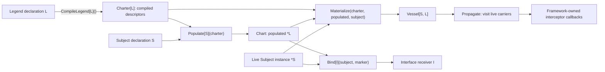

Sail
====

## Packages

Sail has four public packages in one module:

| Import | Responsibility |
| --- | --- |
| `github.com/qlustra/sail/legend` | Authoring vocabulary: markers, lanes, spots, features, qualifiers, barrels, qualities, acceptance declarations, hook interfaces, and `Self`. These types also hold populated Chart state. |
| `github.com/qlustra/sail/chart` | Chart capabilities: `Course`, `Waypoint`, `Select`, `Traversal`, `Encounter`, `Visitor`, `Visitors`, `On`, and `Visit`. |
| `github.com/qlustra/sail/subject` | Live Subject propagation: `Propagation`, `Interceptor`, `Intercept`, `Order`, `Route`, movement constructors, `Encounter`, `Identity`, `Enterable`, `Children`, and `Iterate`. |
| `github.com/qlustra/sail` | Lifecycle entry points and holders: `Charter[L]`, `CompileLegend`, `Charter.Compile`, `Populate`, `Charter.Traverse`, `Vessel[S, L]`, `Materialize`, `Vessel.Traverse`, `Vessel.Propagate`, `Bind`, `ReadCapability`, and `ResolvePointerChain`. |

Declaration examples use `legend`:

```go
import "github.com/qlustra/sail/legend"

type TreeLegend struct {
    legend.Legend
    // Declare lanes and spots here.
}

func (TreeLegend) Mark() string { return "tree" }
```

Orchestration imports root `sail`:

```go
charter, err := sail.CompileLegend[TreeLegend]()
populated, err := sail.Populate[Tree](charter)
vessel, err := sail.Materialize[Tree](charter, populated)
```

Root implementation files follow those responsibilities: `charter.go` contains
the Charter and its compilation, population, and traversal entry points;
`vessel.go` contains the Vessel, materialization, and propagation entry point;
`bind.go` handles live binding; `declaration.go` contains the static declaration
utilities. Chart navigation types belong to `chart`, live propagation types to
`subject`, and authored declarations to `legend`.

The implementation is organized under `internal/`:

| Package | Responsibility |
| --- | --- |
| `declaration` | Canonical declaration types, populated Chart state, carrier references, and the sealed access used by the engine. Public `legend` types alias these types. |
| `chart` | Canonical Course, Waypoint, Encounter, visitor, and Traversal types, plus Chart traversal execution. Public `chart` types alias these types and its generic helpers forward here. |
| `subject` | Canonical propagation, interceptor, routing, encounter, identity, and member-entry types, plus live propagation execution. Public `subject` types alias these types and its constructors forward here. |
| `engine` | Compiled descriptors, compilation, population, Chart navigation and route planning, Vessel association checks, and live binding through carrier references. |
| `capability` | Interface contract matching, declaration capability readers, and guarded declaration invocation. |
| `tags` | Tag parsing and validation. |
| `reflectutils` | Type inspection, field access, and receiver binding, independent of Sail's declaration model. |

`Charter[L]` keeps compiled descriptors private. Public `legend` types alias
canonical internal declaration types, so reflection reports those canonical type
names. Public `chart` and `subject` aliases likewise retain the private state
shared by registrations, encounters, and their respective traversal execution.
These arrangements keep internal cooperation out of the public APIs.

## Vocabulary and lifecycle

Sail interprets Subject declarations using a framework-authored Legend. A Subject
can be a tree, a subsystem, or another runtime component.

| Term | Meaning |
| --- | --- |
| Legend | The framework's authored declaration `L`, rooted in `legend.Legend`, describing markers, ordered lanes, spots, metadata, and contracts. |
| Charter | The reusable compiled descriptor graph produced by compiling a Legend. Its Go type is `sail.Charter[L]`. |
| Chart | The populated `*L` describing a particular Subject declaration. It holds marker occurrences, metadata, and carrier references. |
| Subject | The runtime value Sail works with. Distinguish its declaration `S` from its live instance `*S` when relevant. |
| Marker | The collective term for Regions and Landmarks in a Legend or Chart. The root Legend also participates in the marker contract. |
| Carrier | The Subject field represented by a marker. Its declared type is the carrier type; a live Subject supplies its value. The root Legend uses the Subject root itself as its carrier. |
| Vessel | The operational holder associating a Charter, Chart, and live Subject. Its Go type is `sail.Vessel[S, L]`. |
| Populated marker | A marker value representing a particular carrier in the Subject declaration. |
| Carrier reference | A populated marker's recorded Subject root type, carrier type, and field path, used for later live binding. |
| Receiver | The Go value or pointer used to invoke a method. Binding adapts a live carrier to the requested interface receiver. |
| Navigator | The machinery responsible for access and movement through a topology. It is not a public interface in this slice. |

**Declarations** are authored Go structures. **Descriptors** are Sail's internal
compiled representation. The Chart has the Legend's Go shape:
`Populate` returns `*L`. The Legend defines the representation; the Chart fills it.

Markers belong to the Legend and Chart; carriers belong to the Subject. In a
field declaration such as `Remote Remote`, the field is the carrier and its
declared type is `Remote`. A live Subject supplies its value, while a method
receiver may be that value or its address. Carrier is vocabulary for existing
Subject fields and values, not an additional Go wrapper type.



Compilation and population inspect declarations. Population invokes declared
capabilities on zero-valued surrogates; it requires no live Subject instance.
Chart traversal uses the `chart` package's connected Courses and visitors through
the Charter's traversal entry point. It resolves the Course, then visits
selected markers. Binding resolves a populated marker against an existing
Subject. Materialization associates the Charter and Chart with a live Subject.
Subject propagation uses that association to visit live carriers, with framework
callbacks controlling movement. Unrestricted Chart crawling remains future work.

## Population

`CompileLegend[L]()` builds a Charter with the Legend declaration L.
To compile an existing `Charter[L]`, call `charter.Compile()`. Compilation validates
declarations before replacing the Charter's descriptors; a failed compilation
leaves an existing Charter unchanged.

`Populate[S](charter)` returns a fresh Chart (`*L`) populated against **S's type**.
The Charter holds reusable descriptors; populated markers hold metadata and
carrier references for individual occurrences. Markers expose
`CarrierType()` and a copied `CarrierPath()` so consumers can interpret
carrier types and retain declaration order across spot kinds. The type is the
original declared field type, including pointers. The root Legend reports the
Subject root type and an empty path.

Population reads marked Subject fields in declaration order, selecting spots
within the current lane. An unmatched field advances to the next lane only
after the current lane's minimum counts are satisfied. A matched spot exceeding
its maximum fails immediately; population does not retry another lane to make
the counts fit. End of declaration validates every remaining minimum.

Features receive text from their named tags. Qualifiers receive the remaining
mark values after discriminant selection. Untagged fields are ignored; marked
fields must be exported and match a remaining spot. Legends and regions apply
to structs (including through pointers); landmarks describe leaf declarations.

Single spots hold one marker in `Value`, optional spots hold a marker pointer
or nil in `Value`, and multi spots hold a slice in `Value`. Repeated carrier
types are populated independently.
Composite spot declarations must embed their spot base and intermediate
wrappers by value. Compilation rejects pointer embeddings along that chain;
`OptionalSpot.Value` still uses nil to represent an absent occurrence.
An active cycle of the same marker and carrier types is rejected because it
would require an infinite expansion. Live Subject binding remains separate.

## Materialization

`Materialize[S](charter, populated)` creates a Vessel with a fresh zero-valued Subject
allocated by `new(S)`. To retain an existing Subject, supply its
pointer as the final argument; both generic parameters can then be inferred:

```go
fresh, err := sail.Materialize[Tree](charter, populated)

// One Subject can be shared by Vessels using different Legends.
tree := &Tree{}
attached, err := sail.Materialize(charter, populated, tree)
```

The variadic tail represents one optional Subject. More than one pointer and an
explicit nil pointer are errors. Materialization checks that the Charter is
compiled, the Chart is populated with the corresponding Legend, and the live
Subject root can bind to its recorded reference. On failure it returns no Vessel.
It retains the supplied Charter, Chart, and Subject without copying them.

`vessel.Subject` exposes the actual `*S`. Fresh Subjects are independent; supplied
Subjects preserve their existing state and identity. Materialization does not
allocate nested pointer fields, invoke Subject hooks, or perform framework
composition. If S is itself a pointer type, fresh `new(S)` leaves its pointee
nil, which is an invalid Subject root. Frameworks construct
and configure their own state before or after materialization as appropriate.

`vessel.Traverse(traversal)` accepts `chart.Traversal` and forwards Chart traversal
to the retained Charter and Chart. Visitors receive populated markers; this is
not live Subject walking.

`vessel.Propagate(order, propagation)` accepts an explicit `subject.Order` and a
`subject.Propagation` interceptor list. It walks the retained live Subject using
the Charter and populated Chart.

## Chart traversal

A **Course** is a reusable sequence of **Waypoints**. The `chart` package owns
navigation over populated Charts. Each waypoint selects exactly one immediate
child marker, starting at the Chart root:

```go
import "github.com/qlustra/sail/chart"

course := chart.Course{
    chart.Select[*CommandRegion](),
    chart.Select(func(command *CommandRegion) bool {
        return command.Name.Get() == "validate"
    }),
}

err := charter.Traverse(populated, chart.Traversal{
    Course: course,
    Visit: chart.Visit(func(command *CommandRegion, encounter chart.Encounter) error {
        fmt.Println(encounter.Depth(), command.Name.Get(), encounter.Destination())
        return nil
    }),
})
```

The Chart navigator follows the Charter's lane and spot descriptors to existing
populated markers. Lanes and spots describe incoming relationships, not extra
waypoints. A selector never searches deeper descendants to fill a missing step.
Lane order is preserved; candidates within a lane follow Subject declaration
order across spot kinds. Nil optional spots and empty multi spots have no children.

Before processing, Sail resolves the **entire Course** into an internal
**RoutePlan**. Every step must have exactly one match; a missing or ambiguous
later step fails without invoking any visitor. A Course stores only selection
instructions and may be reused against another compatible Chart. A RoutePlan
retains the concrete occurrences for that execution and is not exposed publicly.

`Select[T]()` matches marker values, pointers, or interfaces; its optional
predicate receives a **shallow copy of the concrete marker**. Pointer predicates
receive a pointer to that copy. Nested pointers, slices, and maps retain normal
Go sharing semantics. Predicates must be read-only; Sail does not deep-copy the
Chart or detect mutations. Interface adaptation prefers the marker's pointer.

`chart.Traversal.Visit` always holds a `chart.Visitors` list. `chart.Visit[T]`
constructs a single-item list; `chart.On[T]` constructs one visitor for composing
a list:

```go
Visit: chart.Visitors{
    chart.On(inspectCommand),
    chart.On(inspectFlagBag),
    chart.On(inspectFlag),
},
```

Each selected encounter passes through the list in registration order. Every
matching typed visitor runs; an unmatched callback does not remove a waypoint or
prevent other visitors from participating. Pointer visitors receive the original
Chart marker, so later visitors see earlier visitors' metadata changes. Visitor
registrations are copied on entry; the list must be nonempty and contain no nil
entries, checked before selectors or visitors run.

The topology must remain stable during planning and execution. No declaration
hooks or live Subject methods are invoked by navigation itself. Selector and
visitor panics propagate normally. The first visitor error ends both the list and
the traversal, preserving its cause with waypoint and visitor context.

An **Encounter** records the arrival and its route context:

- `Marker()` returns the populated marker pointer; `Parent()` returns its parent
  encounter and a presence flag. The root Legend is retained as an ancestor but
  is not itself visited.
- `Depth()` counts marker edges from the root (zero); the first selected marker
  has depth one. `Step()` is the zero-based Course index, or -1 at the root.
- `Destination()` identifies the final selected marker.
- `LanePath()` is relative to the parent marker; `SpotPath()` is relative to the
  lane. Both return copied field-index paths. `ItemIndex()` gives the multi-spot
  slice index, zero for single/optional spots, or -1 at the root. These describe
  positions in the Chart, independently of the marker's `CarrierPath()`.

Chart traversal requires a nonempty Course and visitor list. It does not provide
crawling, descendant-search waypoints, or movement controls. Live Subject
propagation has its own callbacks and movement decisions.

## Subject propagation

Propagation visits the live Subject's participating carriers. The populated
Chart supplies participation and declared topology; interceptors supply
operations, movement, and local visit order:

```go
import "github.com/qlustra/sail/subject"

err := vessel.Propagate(subject.DepthFirst, subject.Propagation{
    subject.Intercept[DeepLoader](
        func(node DeepLoader, at subject.Encounter) (subject.Route, error) {
            if _, err := node.LoadDeep(ctx); err != nil {
                return subject.Abort(err)
            }
            return subject.Prune(), nil
        },
    ),
    subject.Intercept[Loadable](
        func(node Loadable, at subject.Encounter) (subject.Route, error) {
            if _, err := node.Load(); err != nil {
                return subject.Abort(err)
            }
            return subject.Descend(subject.DepthFirst), nil
        },
    ),
})
```

The root Legend represents the Subject root and is visited at depth zero.
Declared children follow the Chart's lane order and the Subject's declaration
order across spot kinds. Optional spots without a value and empty multi spots
produce no child occurrences. Untagged fields, including Go embeddings, remain
outside the topology. Interfaces route operations after a participant is reached;
they do not establish participation.

`Intercept[I]` requires an ordinary Go interface contract. Each occurrence tries
registrations in order, binding its current live carrier to I. Unmatched contracts
pass automatically. The first accepting callback controls movement:

| Route | Effect |
| --- | --- |
| `Pass()` | Decline this registration and try the next interceptor. |
| `Descend(order)` | Accept the occurrence and visit its children in the explicit order. |
| `Prune()` | Accept the occurrence, skip its children, and continue siblings. |
| `Stop()` | Finish the whole propagation successfully. |
| `Abort(err)` | Return a stopping route and the original error for direct forwarding. |

When every interceptor passes or none matches, Sail descends using the enclosing
scope's order. An empty list is valid and follows the explicitly chosen initial
order throughout. Registrations are copied on entry.
Unregistered zero interceptors, invalid interface contracts, and nil callbacks
fail before any handler runs.

Initial and local orders must be `DepthFirst` or `BreadthFirst`; the zero value
is invalid. Depth-first completes each branch before its next sibling.
Breadth-first reaches siblings before their descendants. An accepted route's
local order governs its descendant scope. A different order finishes that scope
before the enclosing walk resumes. For example, a breadth-first root with
children A and B normally visits `root, A, B, A1, A2`; if A chooses depth-first,
the sequence becomes `root, A, A1, A2, B`.

`Descend` accepts at most one optional completion callback:

```go
return subject.Descend(subject.BreadthFirst, func() error {
    return node.Wrapup(ctx)
}), nil
```

Completion runs after every child scope has succeeded, even during breadth-first
propagation. It can retain the accepted receiver and local state through its
closure. `Stop`, returned errors, and panics cancel pending completions;
completion is successful wrapup rather than failure cleanup. Passing nil means
no completion callback. Invalid order and extra completion arguments are reported
by propagation rather than panicking in the constructor.

Binding uses the existing Subject values and happens when each registration is
reached. A callback can change Subject state before returning `Pass`; the next
registration binds again. A parent can initialize or replace a child before
returning `Descend`. Sail refreshes the carrier and its identity again before
descent. Pruned branches never need binding. Sail does not allocate live Subject
values or construct addressable receiver copies. Ordinary Go receiver semantics
still apply to interface fields holding concrete non-pointer values.

Nil pointer and interface branches are skipped, including interfaces containing
typed nil pointers. Nil maps and slices remain valid receivers. Propagation
validates a nonnil Subject root before callbacks; wrong roots and inaccessible
receivers are errors. Propagation leaves `Bind`'s strict nil handling unchanged.

### Entered members

A reached carrier may implement `subject.Enterable` to supply additional live
children. Its `Enter` method returns opaque `Children` constructed with the
typed `Iterate` helper:

```go
func (s *Slot[T]) Enter() (subject.Children, error) {
    return subject.Iterate(s.All()), nil
}
```

`All` supplies `iter.Seq2[K, T]`: keys identify members in diagnostics, and source
order determines member order. `Iterate` retains the declared T even for an empty
source. Sail interprets that type through the current Charter's Legend and reuses
its populated member Chart during this propagation. Member roots join the same
walk with the collection encounter as parent, continuous depth, and the same
interceptors. The source owns discovery, composition, and caching.

`Enter` runs after interceptors permit descent; `Prune` bypasses it. Declared
children precede entered members in the child sequence. Enumeration stays lazy
and honors iterator early termination when propagation stops or fails. `Enter`
may return a setup error; ordinary `iter.Seq2` has no later error channel. Nil
iterators and zero `Children` are invalid. Declared member types must satisfy
Legend population, including its struct-root requirement; interface-declared
members are not populated through dynamic type discovery.

Pointer members retain their actual storage. Yielded values remain value copies,
without fabricated addressability; their real pointer fields still lead to live
state. A pointer-only contract on an unaddressable yielded value fails with the
ordinary receiver-binding error. Nil pointer members are skipped.

### Identity and cycles

Sail records reliable receiver identity per propagation. Shared instances remain
separate occurrences and can receive the same operation through several routes.
The encounter exposes `First()` for first-arrival work and `Cycle()` for a return
to an ancestor on this route:

```go
if at.First() {
    if err := node.Setup(ctx); err != nil {
        return subject.Abort(err)
    }
}
if _, cyclic := at.Cycle(); cyclic {
    return subject.Prune(), nil
}
return subject.Descend(subject.DepthFirst), nil
```

`First` describes arrival history, not whether any operation ran or succeeded.
Rebinding the same receiver after `Pass` preserves that encounter's original
first-arrival fact. A replacement receiver gets its own identity and history.
`Identity()` is opaque and comparable within this propagation, for callers who
need additional bookkeeping. Value members identify their yielded occurrences,
not objects in an external cache.

A cyclic arrival is offered to interceptors so callers can perform work and
choose `Prune`, `Stop`, or an error. Sail rejects descent while the cycle remains
closed, including automatic descent after all interceptors pass. Cycle detection
follows the encounter's logical ancestry regardless of visit order; shared
receivers in other branches are not cycles. An ancestor scope retains the receiver
bound when its descent began. Later field replacements affect future arrivals,
without reassigning that scope or its pending completion. Identity is established on arrival
and refreshed during rebinding and before descent. Ambiguous identity is rejected
rather than guessed. Inline zero-sized fields use their containing receiver and
field provenance; pointers to zero-sized targets are rejected because Go may
assign distinct targets the same address. The explicitly supplied root has known
invocation provenance. No preflight of live instance edges is performed.

The Chart's topology must remain stable throughout propagation; live Subject
state may change. Callbacks own their operations, context, and method calls.
Returned errors stop propagation, retaining the cause with occurrence and
interceptor, entry, or completion context. Callback panics propagate normally.
There is no error-recovery or accumulation policy. A `subject.Encounter` reports
the occurrence independently of Chart Course selection:

- `Marker()` returns the populated marker pointer; `Parent()` returns the parent
  encounter and a presence flag. The root has no parent.
- `Depth()` counts marker edges from the root; `Source()` identifies the carrier
  location, including entered member keys, for diagnostics.
- `CarrierType()` gives the original declared carrier type; `CarrierPath()` gives
  its field-index path from the Subject or entered member root.
- `LanePath()` is relative to the parent marker; `SpotPath()` is relative to its
  lane. `ItemIndex()` gives the multi-spot index, zero for single/optional spots,
  or -1 at a root. All path accessors return defensive copies.
- `First()`, `Cycle()`, and `Identity()` report this arrival's identity facts.

Subject propagation does not use Chart Courses. Local routing and typed member
entry operate on the participating live topology.

## Live binding

`Bind[I](subject, marker)` finds the marker's carrier in the live Subject and
returns an ordinary Go interface receiver:

```go
command := &populated.EntryPoint.MainCommand.Value
receiver, present, err := sail.Bind[Runnable](&program, command)
if err != nil {
	return err
}
if present {
	return receiver.Run(ctx)
}
```

The root must be a nonnil pointer leading to the exact recorded root type;
additional pointer wrappers are allowed. Sail follows the stored field path
without allocating Subject values or constructing addressable copies.
Addressable concrete fields bind through their address when it implements I, preserving the
connection to their original carrier even for value-receiver interfaces.

Interface fields expose their current dynamic receiver. A stored non-pointer
value follows normal Go value semantics; if only its pointer implements I, an
addressability error is returned. Replacing a pointer or interface field requires
rebinding to obtain the replacement. Nil maps and slices remain valid values.

`present == false` without an error means that the existing receiver does not
implement I. Wrong roots, unpopulated or nil markers, nil pointers or interfaces,
inaccessible receivers, and receiver cycles produce contextual errors.
I must be an interface; `Self` signature templates are not substituted into a
runtime Go interface.

Binding invokes no Subject methods and does not traverse siblings or descendants.
The caller owns invocation and its error handling. Chart Course selection can
supply a marker to bind; Subject propagation uses the same receiver semantics
while adding nil-branch skipping and movement control.

## Acceptance

A marker can constrain its carrier type with an optional declaration hook:

```go
func (EnumOptionLandmark) Accept() legend.Acceptance {
	return legend.AcceptExact[bool]()
}
```

Compilation invokes `Accept` once per marker declaration type on its zero-valued
surrogate and records the compiled rule in its descriptor. Returning an empty `legend.Acceptance`, an invalid
kind or contract, or panicking in the hook fails compilation. The declaration
builders do not panic on invalid input. Without the hook, existing role
requirements apply.

Each declaration selects one rule:

- `AcceptExact[T]()` compares the original declared type. Aliases of T pass;
  distinct defined types and pointers to T do not. Interface types also match
  by identity: `AcceptExact[any]()` requires a field declared `any`.
- `AcceptKind(reflect.String)` compares the original declared kind. Defined
  string types pass; pointers do not. Collection kinds impose no element
  constraints. `reflect.Invalid` and unknown kinds are invalid declarations.
- `AcceptContract[C]()` requires an interface contract or a struct's complete
  exported method set. A struct template includes methods on C and *C; pointer
  templates resolve to their struct type. Candidates may add methods, but must
  preserve every required method's parameter and result types and variadicness.
  Receivers, struct fields, and private concrete methods are not compared.
  Embedding the struct supplies its methods unless a field or incompatible
  override shadows them. Interface contracts retain Go's implementation rules,
  including private methods, and use the same `Self` matching as qualities.
  Carrier pointer chains resolve to a type T, preserving defined-type identity.
  Concrete carriers support methods on T or *T; interface declarations use their
  own method set. Direct `Self` parameters and results resolve to T, including
  when T is an interface. No surrogate is constructed and no Subject method is
  invoked. Contracts other than interfaces or structs and unsupported `Self`
  signatures fail compilation. Barrels and qualities still require interface
  contracts and concrete receivers for invocation.

For example, a struct template can require a carrier's full public API while
allowing extensions through embedding:

```go
func (FileLandmark) Accept() legend.Acceptance {
	return legend.AcceptContract[File]()
}

type CustomFile struct {
	File
}
```

Population checks acceptance before filling that occurrence's metadata,
descending, or invoking its capabilities. Legends and regions must still resolve
to structs. Rule combinations and collection element constraints are not defined.

Marks and lanes select the occurrence first. An acceptance mismatch fails with
the Subject path, marker, expected type, and actual type; it does not retry
another spot or advance the lane. Only selected occurrences are checked;
untagged fields remain outside population.

## Barrels

A barrel declares a capability, selects a method, and stores its result during
population:

```go
type Descriptive interface {
	About() string
}

type CommandRegion struct {
	legend.Region
	Description legend.Barrel[string, Descriptive] `sail:"barrel" populate:"About"`
}

func (CommandRegion) Family() string { return "command" }
```

The capability must be an interface. Its selected method must be exported, take
no arguments, and return exactly one value assignable to the barrel's value
type. Compilation validates this contract before any Chart is populated.

Omitting `barrel` means `barrel:"optional"`: an unavailable capability leaves
the barrel empty. `barrel:"required"` instead makes absence a population error.
Availability requires a concrete carrier type whose pointer implements the
interface; this covers value and pointer methods. An interface-typed carrier
cannot supply a concrete surrogate from its static declaration alone.

After the occurrence's fields and child lanes are populated, each barrel calls
its selected method on a fresh zero-valued surrogate. Hooks must work without
initialized subject state. A hook panic fails population with the Subject
path and barrel field in the error. Multiple barrels may select the same method;
they invoke independently and each stores its result.

`Description.Get()` reads the stored value. `Description.Present()` distinguishes
an absent capability from a successful call returning `""`, zero, or nil. Neither
accessor invokes hooks or validates values. No separate behavior registration or
population hook is required.

## Qualities

A qualifier composite can declare capabilities required when its symbol is
present on a Subject occurrence:

```go
type Defaultable[T any] interface {
	Default() T
}

type DefaultQualifier struct {
	legend.Qualifier
	Value legend.Quality[any, Defaultable[legend.Self]] `sail:"quality" populate:"Default"`
}

type Argument struct {
	legend.Landmark
	Default DefaultQualifier `sail:"qualifier" symbol:"default"`
}

func (Argument) Family() string { return "arg" }

type Remote string

func (Remote) Default() Remote { return "origin" }
```

For a carrier declared `Remote Remote` and marked with `arg,default`, population
requires and invokes `Default() Remote`. Without the qualifier, the quality
stays inactive: no capability is required or invoked. This association comes
from nesting, not from the symbol's meaning. Reusable qualifier wrappers retain
the qualities declared along their embedded `Qualifier` path.

`Self` matches the carrier type after pointer normalization, preserving
defined-type identity. It is a signature placeholder, not a Go interface that
the carrier type must literally implement. Sail checks the entire capability's
method set. This slice supports Self directly in method parameters and results;
compound uses such as `[]Self` and `*Self` fail compilation. Interfaces using
Self must have exported methods. Ordinary interfaces use Go's implementation
rules, including private methods.

The selected `populate` method must be exported, take no arguments, and return
one value. Fixed result types are checked for assignability to the value type
during compilation; Self results are checked during population. Self cannot be
used as the value type. With `any`, `arg.Default.Value.Get()` returns an
interface containing the actual `Remote` value, not a converted string.

Each active quality invokes its method on a fresh zero-valued surrogate, after
the occurrence's fields and child lanes are populated. Missing or mismatched
capabilities, incompatible result types, and hook panics fail population with the
Subject and qualifier context. `Present()` distinguishes an inactive quality
from a successful zero or nil result. Reading a quality never invokes or
validates its value. Live-value parsing and validation remain separate.

## Declaration utilities

`ResolvePointerChain(typ)` follows pointer types without erasing the identity of
the resulting defined type. Nil input or a pointer cycle returns nil. An
interface remains an interface; a declaration alone cannot resolve its concrete
implementation.

`ReadCapability[V, I](typ, method)` reads a declaration capability without a
Charter, populated Chart, or qualifier. It uses the same contract matching and invocation machinery
as qualities:

```go
value, present, err := sail.ReadCapability[any, Defaultable[legend.Self]](
	reflect.TypeFor[Remote](), "Default",
)
```

I must be an interface. Its selected method must be exported, take no arguments,
and return one value assignable to V. Self follows the same direct-signature
rules as qualities. In this example, `value` contains a `Remote`, preserving its
dynamic type.

An unavailable or incompatible capability returns `present == false` without
an error. This includes nil, cyclic pointer, and interface carrier types that
cannot supply a surrogate. Invalid capability requests, incompatible result types,
and hook panics return errors. A successful zero or nil result still returns
`present == true`.

Every call constructs a fresh zero-valued surrogate and invokes independently;
it does not access a live Subject or cache results. The caller decides whether
to request a capability and how to use its result. Qualities instead retain
their compiled reader in the Charter and require presence when activated.

## Lane policies

Lanes form ordered bands in a Subject declaration. Spots are unordered
alternatives within a lane. The `exploration` tag declares how fields are
assigned to lanes:

| Policy | Meaning |
| --- | --- |
| `eager` | Stay in the current lane while it accepts the field. |
| `unambiguous` | Reject structural overlap between reachable lanes during compilation. |

Omitting `exploration` selects `unambiguous`.

Compilation rejects an unambiguous lane whose marks overlap a following lane
reachable through zero-occurrence lanes. A lane permits zero occurrences only
when every spot's minimum is zero. Lookahead includes the first required lane,
then stops. Marks are compared by tag, family, and discriminants; features and
qualifiers do not distinguish them. Ambiguous spots within one lane are rejected
under every policy.

Cardinality remains a separate population constraint. Finite maximum counts do
not resolve structural overlap, and satisfying counts does not excuse violating
the declared lane strategy.
